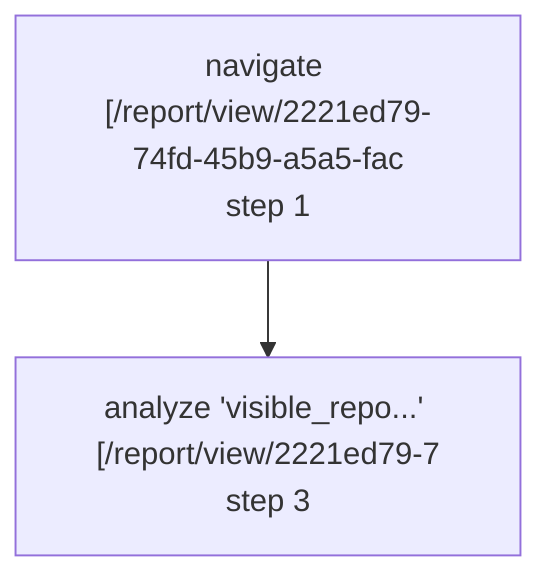

# DAG Action Graph

## Node Legend

| ID | Signature | First Seen |
|-----|-----------|------------|
| N0 | `http://localhost:4021/report/view/2221ed79-74fd-45b9-a5a5-fac5d6cc7c18\|navigate\|\|none` | step 1 |
| N1 | `http://localhost:4021/report/view/2221ed79-74fd-45b9-a5a5-fac5d6cc7c18\|analyze\|visible_report_title_check\|none` | step 3 |
