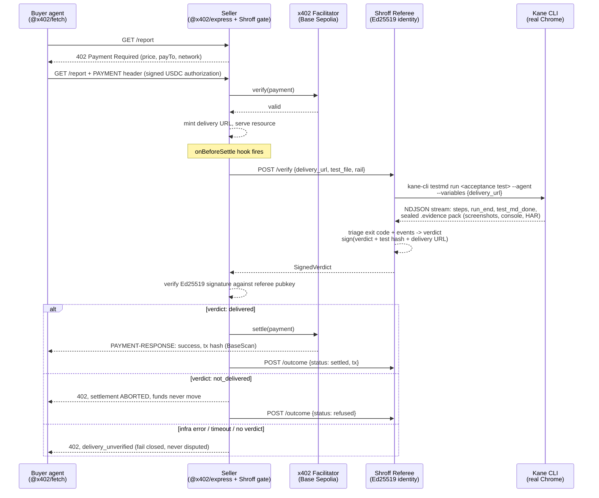
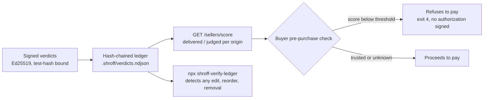

# Shroff

**The delivery referee for agent payments. Kane CLI is the judge; money moves only on its signed verdict.**

Live: **https://shroff-production.up.railway.app** · Demo video: **[YouTube](VIDEO_URL_HERE)** · Built for the [KaneCLI Online Hackathon](https://www.kaneclihack.sh/) (TestMu AI, Nov 2026)

## The problem

x402 lets an AI agent pay for an HTTP resource with USDC. Settlement is final and has no dispute process: a seller can accept payment and return junk, an error, or nothing. Every existing mitigation (oracle scoring, escrow contracts, payment-proof checks) validates the *API response*. None of them verifies what a buyer actually *sees* after paying.

Shroff closes that gap: after payment, **Kane CLI walks the delivery in a real Chrome browser** against the seller's published promise, and the x402 settlement executes **only if Kane's run passes**. The verdict is Ed25519-signed, hash-chained into a ledger, and backed by Kane's sealed evidence pack.

## How a purchase works



The same gate drives the fiat rail: Stripe PaymentIntent with `capture_method: manual`, authorize → Kane verdict → **capture** or **cancel**. One referee, two rails.

## The trust layer

Every signed verdict lands in an append-only, hash-chained ledger. From it the referee computes per-seller delivery scores that buyers check **before paying**:



A seller caught defrauding once is branded `untrusted` (score 0); the demo buyer then refuses to even sign a payment authorization for it.

## What Kane verifies (no hand-written tests)

The seller publishes a plain-English promise (`delivery-spec.md`). It is compiled through **Kane's own assurance pipeline**, never by hand:

```
kane-cli context ingest delivery-spec.md --mode agent   # -> use-case uc-1
kane-cli design tests --use-case uc-1 --mode agent      # -> criterion-linked _test.md
kane-cli context review --approve ac-N --mode agent     # -> approved criteria
```

`@shroff/spec-compiler` automates this (`npx tsx packages/spec-compiler/src/cli.ts <spec.md>`). The generated test is committed, and its SHA-256 is bound into every verdict signature, so the acceptance test cannot be quietly softened after the fact.

## Verdict triage (fail closed)

| Kane result | Verdict | Settles? | Disputable? |
|---|---|---|---|
| exit 0 + `test_md_done: passed` | `delivered` | yes | – |
| exit 1 / `test_md_done: failed` | `not_delivered` | **no** | yes |
| exit 2 (env/auth), signal kill, unknown exit | `infra_error` | **no** | **no** |
| exit 3 (timeout), watchdog kill | `timed_out` | **no** | **no** |
| any run without a final verdict event | `incomplete` | **no** | **no** |
| `reason: infra_error.*` in `run_end` | `infra_error` | **no** | **no** |

Infrastructure failures are never blamed on the seller, and nothing settles without a positive verdict. A hung `kane-cli` is killed by an outer watchdog; a referee restart yields a signature mismatch that the seller **rejects** (proven live).

## Run it as a judge

Requires Node >= 20, Chrome, and a free [TestMu](https://testmuai.com) account (`kane-cli login`).

```
git clone https://github.com/bomanaps/Shroff && cd Shroff
npm ci && npm i -g @testmuai/kane-cli && kane-cli login
npm run demo
```

`npm run demo` runs five acts in one command: honest x402 settle (real tx hash) → fraud caught, settlement refused → trust scoreboard + buyer refusal → Stripe capture-on-pass → ledger chain verification. Or use the deployed site's buy buttons at the URL above; every run streams live (steps, browser evidence, verdict, BaseScan link).

Tests: `npm test` (46 across gateway, spec-compiler, loop, referee, including a fake Kane binary covering ENOENT, SIGKILL, hang, and truncated output). CI runs typecheck + suite on every push.

## Money and keys

- **x402 rail:** Base Sepolia **testnet**, public x402.org facilitator, USDC from the free Circle faucet. The buyer/seller wallets ship in `.env.judge` **by design** so judges can run one command; they hold nothing of value and every settlement is public on [BaseScan](https://sepolia.basescan.org).
- **Stripe rail:** sandbox mode only; the server refuses any key that is not `sk_test_`. Payment method is Stripe's published test card. Judges use their own free test key (or skip the fiat demo).
- No mainnet keys, no real cards, no real funds exist anywhere in this repository.
- The three demo fraud modes are planted and disclosed (`FRAUD_MODE=blank|bait|locked`).

## Repository layout

```
packages/gateway        Kane NDJSON parser, fail-closed triage, x402 onBeforeSettle gate
packages/referee        neutral verifier: Ed25519 signing, hash-chained ledger, trust scores,
                        SSE live feed, evidence unsealing, the deployed web UI (ui/)
packages/spec-compiler  delivery promise -> Kane assurance pipeline -> committed _test.md
packages/buyer          x402 + Stripe buyer agents with pre-purchase trust check
packages/loop           verdict -> repair prompt -> coding agent -> re-verify (3 tries, then human)
apps/seller-honest      demo seller that keeps its promise
apps/seller-evil        demo seller with three disclosed fraud modes
apps/seller-fiat        same referee on Stripe authorize/capture
demo/judge-demo.ts      the five-act one-command demo
```

Developer integration guide: **[/docs on the live site](https://shroff-production.up.railway.app/docs)** or [docs/INTEGRATION.md](docs/INTEGRATION.md).

## Built with

Kane CLI (`testmd run --agent`, assurance pipeline, sealed evidence packs, NDJSON contract) · Claude Code (builder + repair agent) · `@x402/express` / `@x402/fetch` / `@x402/core` v2.31 · Stripe API (test mode) · three.js (the UI's scroll world) · plain TypeScript, no frameworks.

Launch posts: [Reddit](REDDIT_URL_HERE) · [LinkedIn](LINKEDIN_URL_HERE)

MIT © bomanaps
